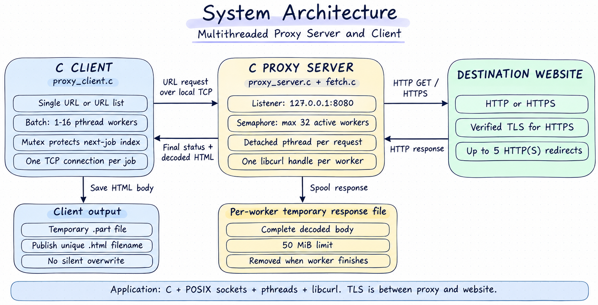
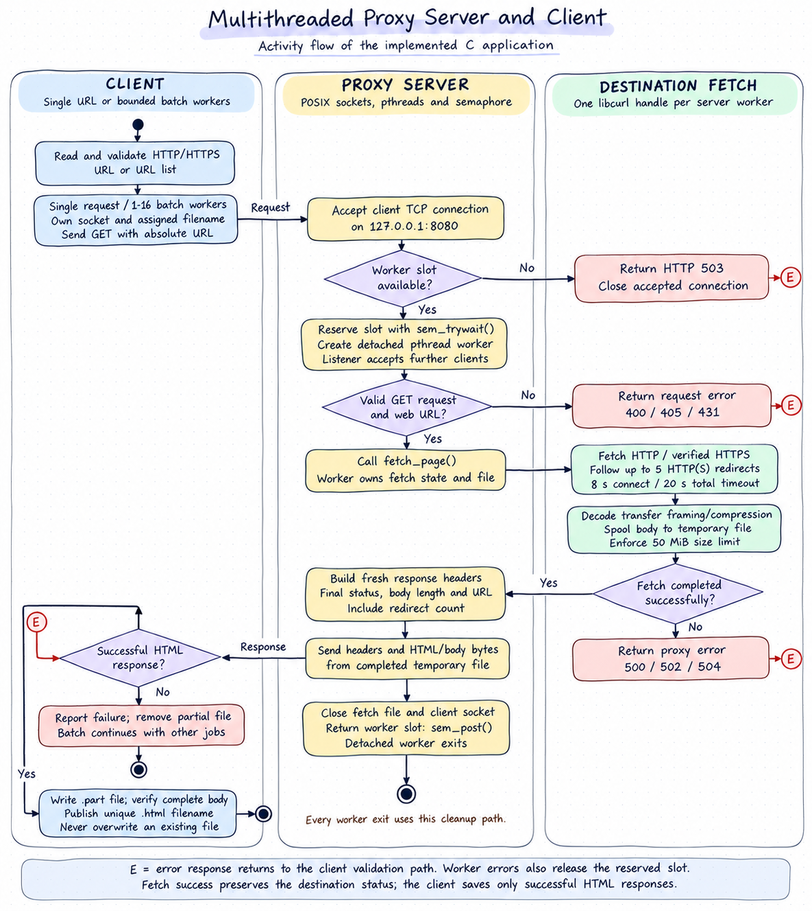
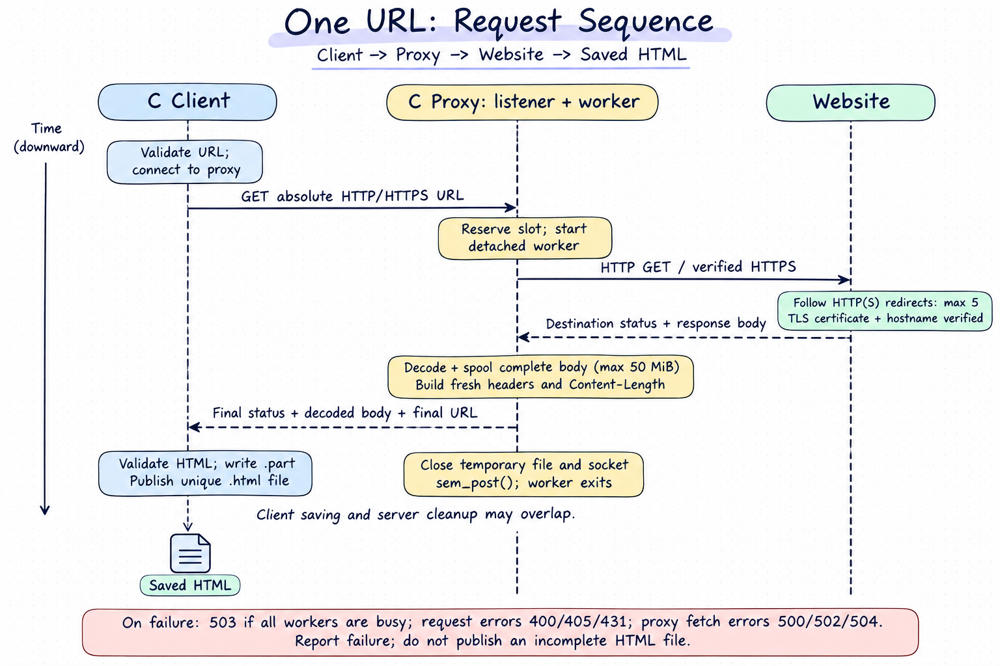

# Multithreaded Proxy Server and Client

A C-based operating systems project that fetches HTTP and HTTPS webpages through a multithreaded proxy server and lets a client save the returned page as an HTML file.

> **Status:** Milestones 1-4 implemented: HTTP/HTTPS fetching, bounded redirects, HTML saving, and bounded multithreading in both server and batch client.

## Overview

A proxy server acts as an intermediary between a client and a destination web server. Instead of fetching a page directly, the client sends its URL to the proxy. The proxy retrieves the response and sends it back to the client.

This project demonstrates socket programming, concurrent request handling, and resource management. It is based on **Project 6: Multi-threaded Proxy Server and Client** from the proposed OS project list.

## Project Requirements

- Develop a multithreaded proxy server and a client.
- Accept a URL from the client, fetch the corresponding page, and return the response.
- Allow the client to save the returned page as an HTML file with an appropriate filename.

## Implemented Features

- **URL input:** Accept an HTTP or HTTPS URL through the command-line client, including a path, query string, and explicit port. URL fragments are not sent to the website.
- **Destination fetching:** Each proxy worker uses its own libcurl handle for the website GET request. The client contacts the proxy rather than fetching the website directly.
- **HTTPS and redirects:** Verify the destination certificate and hostname, follow at most 5 redirects, and restrict initial/redirect protocols to HTTP and HTTPS. Display the final URL and redirect count.
- **Concurrent clients:** Serve up to 32 active connections with detached POSIX worker threads. Excess connections receive HTTP 503.
- **Threaded batch downloads:** Download a URL list with 1-16 client workers (default 4). Each job owns its socket and output file; all filenames are assigned before workers start.
- **Request logs:** Server logs carry request identifiers, worker start/finish events, and relayed byte counts. Batch results identify each URL and summarize saved and failed jobs.
- **HTML output:** Save the response body to a chosen filename or generate one under `downloads/`. Automatic names receive numeric suffixes on collision. Explicit filenames are never overwritten.
- **Response handling:** Decode supported destination compression and chunked transfers in the proxy. Return fresh Content-Length framing and save only successful HTML/XHTML bodies in the client.
- **Failure handling:** Report invalid input, connection failures, destination HTTP errors, unsupported responses, and file-write failures. Failed downloads do not leave completed output files.
- **Resource cleanup:** Close sockets and files and release per-request memory. Download into a temporary file and publish it only on success.

Response caching remains an optional extension. A website can still reject automated requests or require authentication or browser execution.

## System Architecture



## How It Works



[Open the scalable SVG diagram](docs/images/project-flow.svg)

### Single Request Sequence



The proxy accepts incoming connections and assigns each accepted connection to a worker thread. Each worker owns a libcurl handle and a temporary response file. It first fetches the complete, decoded body within the size/time limits, then returns the final status, content type, final URL, redirect count, and body. Temporary files are closed on success and failure.

TLS is used between the proxy and an HTTPS destination. The dedicated client connects to the proxy over local TCP on `127.0.0.1`; this project does not implement browser CONNECT tunneling or TLS interception.

Saving an HTML response does not download all linked images, stylesheets, or scripts. A complete offline website downloader is outside the initial scope.

## Technology Stack

| Component | Technology |
| --- | --- |
| Programming language | C |
| Client-to-proxy communication | POSIX TCP sockets and HTTP request/response framing |
| Destination HTTP/HTTPS | libcurl C API with certificate verification |
| Concurrency | POSIX threads (`pthread`) |
| Connection limit | POSIX semaphore |
| Development environment | Linux, or a Linux environment through WSL on Windows |
| Compiler | GCC |
| Version control | Git and GitHub |

## Development Setup

The intended development environment needs:

- A Linux environment with networking access.
- GCC and the development headers needed for sockets and POSIX threads.
- libcurl development headers (7.85 or later), pkg-config, and trusted CA certificates.
- Python 3 and OpenSSL for the local test fixtures only.
- Git for version control.
- A text editor or IDE.

The project was built and tested in Ubuntu through WSL. Run the following commands in a Linux terminal, from the project directory. Native Windows MinGW is not the target for this POSIX implementation.

Install build/test dependencies on Ubuntu if they are not already available:

```bash
sudo apt-get update
sudo apt-get install build-essential libcurl4-openssl-dev pkg-config ca-certificates python3 openssl
```

The server, client, threading, and file handling are implemented in C. libcurl is a C library linked into the server; the application does not invoke the `curl` command or a Python downloader.

```bash
make
```

Start the proxy in one terminal:

```bash
./proxy_server 8080
```

In another terminal, fetch an HTTP page through the proxy:

```bash
./proxy_client 127.0.0.1 8080 https://example.com/ --output page.html
```

Omit `--output` to generate a filename:

```bash
./proxy_client 127.0.0.1 8080 http://example.com/
```

Public sites may redirect or reject automated requests. For a repeatable offline demonstration, create a small HTML page and start a local origin server in a third terminal:

```bash
mkdir -p /tmp/os-proxy-demo
printf '<html><body>Hello from our proxy project!</body></html>\n' > /tmp/os-proxy-demo/index.html
python3 -m http.server 8000 --bind 127.0.0.1 --directory /tmp/os-proxy-demo
```

Then run the client, keeping the proxy running:

```bash
./proxy_client 127.0.0.1 8080 http://127.0.0.1:8000/index.html --output demo.html
```

The output shows the HTTP status, saved body size, and filename. An existing explicit output file causes an error; choose another name or omit `--output` for automatic collision handling.

The listener binds to `127.0.0.1`, so the client and proxy should run in the same Linux environment for this milestone. Stop the proxy with Ctrl+C.

## Multithreaded Batch Client

Keep the proxy and local demo origin running, then run:

```bash
./proxy_client 127.0.0.1 8080 --batch examples/urls.txt --jobs 3
```

The example list requests the local HTML page three times with different query strings. For other pages, create a text file containing one HTTP or HTTPS URL per line. Blank lines and lines starting with `#` are ignored; the whole list is validated before downloads begin.

Each run creates a unique `downloads/batch_XXXXXX/` directory. Files are named with the job number and sanitized hostname/path, such as `0001_127.0.0.1_index.html`. Duplicate URLs and simultaneous batch runs cannot select the same output path.

The client creates no more than `--jobs` worker threads, up to 16. A mutex protects the shared job index; network requests run outside that lock. It joins its workers before reporting the final result. The server independently limits active workers to 32 using a semaphore and releases each slot when its worker exits.

Failed jobs do not stop unrelated downloads. The final summary reports saved/failed counts; the process exits with a nonzero status if any job failed. A batch accepts at most 1000 URLs. `--output` is available only in single-URL mode.

## Source Files

| File | Purpose |
| --- | --- |
| `proxy_server.c` | Accept client connections, create bounded workers, fetch and relay HTTP responses. |
| `fetch.c` / `fetch.h` | Per-worker libcurl fetching, certificate verification, redirects, decompression, limits, and temporary response storage. |
| `proxy_client.c` | Fetch one URL or a batch through the proxy, decode response framing, and save HTML. |
| `net.c` / `net.h` | URL validation, destination resolution, timed connections, and complete socket writes. |
| `tests/integration.py` | Local HTTP fixtures and end-to-end checks. |
| `tests/concurrency.py` | Client worker limits, server saturation/recovery, timeouts, disconnects, and connection churn. |
| `tests/https.py` | Controlled HTTPS certificates, redirects, decoded bodies, mixed batches, size limits, and fetch timeout. |
| `tests/public_smoke.py` | Optional live HTTP/HTTPS checks through the C proxy. |
| `examples/urls.txt` | Small batch input for the local demo origin. |
| `proxy_server_with_cache.c` / `proxy_server_without_cache.c` | Original tutorial reference implementations, preserved separately. |
| `proxy_parse.c` / `proxy_parse.h` | Original tutorial parser; not linked into the new milestone executables. |

`make tutorial` builds the preserved cached tutorial as `tutorial_proxy`. It is a reference target and does not include our dedicated HTML-saving client or fixes.

## Implementation Plan

The required HTTP/HTTPS fetching, HTML-saving client, concurrency, and validation milestones are complete. Caching remains an optional extension.

## Validation Plan

Run the deterministic local checks with Python 3:

```bash
make test
```

For memory and undefined-behavior checks on the new executables:

```bash
make sanitize
make test
```

Return to the normal build afterward:

```bash
make clean
make
```

Normal and AddressSanitizer/UndefinedBehaviorSanitizer builds each passed 29 end-to-end scenarios, 10 concurrency scenarios, and 24 HTTPS/redirect scenarios, with no reported sanitizer errors. These cover 410 sequential requests, 32-slot saturation/recovery, trusted and rejected certificates, hostname verification, HTTP/HTTPS redirects, redirect loops, decoded gzip/chunked content, a decoded size limit, timeout recovery, and mixed-protocol batch downloads. Tests use local origins and temporary certificates, without changing the system trust store. Public HTTP and HTTPS example pages were also fetched successfully through the proxy.

An optional internet check fetches public HTTP and HTTPS example pages through the proxy:

```bash
make smoke
```

For a private CA, start the proxy with an explicit PEM CA bundle. Certificate and hostname checks remain enabled:

```bash
PROXY_CA_BUNDLE=/absolute/path/to/ca-bundle.pem ./proxy_server 8080
```

This replaces the default CA bundle for that server process. The default public-web setup uses the system CA bundle. The HTTPS tests use this mechanism only with certificates generated inside their temporary test directory.

| Scenario | Expected behavior |
| --- | --- |
| Valid HTTP URL returning HTML | Client receives the page and saves its body to an HTML file. |
| Multiple clients at the same time | Requests complete independently without mixed response data. |
| Invalid URL or unsupported scheme | Client receives a clear error. |
| Unreachable destination | Request fails cleanly without stopping the proxy. |
| Destination returns an HTTP error | Client can identify the returned HTTP status. |
| Response larger than one buffer | Data is transferred without truncation. |
| Client disconnects during transfer | Worker cleans up its resources and the server remains available. |
| Output file cannot be written | Client reports the file error. |

## Current Limitations

- HTTP/HTTPS GET webpage fetching only. Authentication, persistent cookie sessions, JavaScript execution, and browser CONNECT tunneling are not implemented.
- The client saves HTML/XHTML only. Destination compression support depends on the installed libcurl build; decoded responses are returned without stale compression or chunking headers.
- Both declared destination sizes and decoded bodies are capped at 50 MiB. Destination/client response headers are limited to 64 KiB per response block; incoming proxy requests are limited to 16 KiB. Each worker uses a temporary disk file, so 32 maximum-size in-flight responses can require about 1.6 GiB of temporary storage.
- Destination fetches have an 8-second connection timeout and a 20-second total timeout. The client waits up to 30 seconds without response progress; incoming server socket operations time out after 15 seconds without progress. System resolver behavior depends on the installed libcurl build.
- At most 5 redirects are followed. HTTP-to-HTTPS and HTTPS-to-HTTP redirects are supported; redirects to other protocols are rejected.
- Declared-length and chunked truncation are detected before returning a successful fetch. An upstream close-delimited body has no declared length with which to distinguish an early clean EOF from completion.
- The server serves at most 32 active requests. Multiple batch clients can exceed that limit and receive HTTP 503; automatic retries are not implemented.
- Completed files are finalized using POSIX hard links. Use a filesystem that supports them. No cache is enabled in the project executables.

## Possible Extensions

- Add a bounded, thread-safe response cache with an LRU eviction policy.
- Add request timing and performance measurements to the existing request logs.
- Compare sequential and concurrent request handling.
- Compare the current bounded per-connection server workers with a persistent worker pool.
- Add configurable fetch limits and richer result metadata.

## Academic Context

Developed for the CSE 302 Operating Systems course. Team details and implementation results will be added when available.
